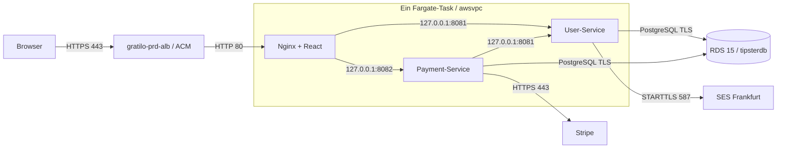

# Gratilo auf AWS ECS Fargate deployen

Repository: `stefanbeike/gratilo`. Produktion: `https://gratilo.eu`.
Region: `eu-central-1`. Infrastruktur wird manuell eingerichtet.
Die vorbereitete Pipeline wurde nicht gegen AWS ausgeführt. Es wurden keine
Ressourcen, Secrets oder DNS-Einträge aus AWS ausgelesen oder verändert.

## Architektur und geprüfter Ist-Zustand



Ein gemeinsamer ECS-Service betreibt die drei essenziellen Container. Innerhalb
eines `awsvpc`-Tasks teilen sie die Netzwerkschnittstelle; Docker-Compose-DNS-Namen
wie `user-service` werden dort nicht vorausgesetzt. Siehe
[Fargate-Netzwerk](https://docs.aws.amazon.com/AmazonECS/latest/developerguide/fargate-task-networking.html).

Der bisherige Release-Workflow erwartete drei getrennte Services. ECR-Push und
ECS-Deployment waren deaktiviert, OIDC fehlte, weitere Tag-/Snapshot-Workflows
duplizierten den Veröffentlichungsweg. `infrastructure/ecs.tf` ist im aktuellen
Repository nicht vorhanden; es wird keine Terraform-Infrastruktur rekonstruiert.
Der bisherige Terraform-Workflow wurde als Referenz nach
`deployment/legacy/terraform-workflow.yml.disabled` verschoben und ist nicht
mehr als GitHub-Workflow ausführbar. Die doppelten ECR-Publisher wurden entfernt.

Die Dockerfiles bauen Java 21 bzw. React/Node 22. Die Backends kopieren die
vollständige Gradle-Anwendungsdistribution einschließlich aller Laufzeit-JARs;
das bisher allein kopierte dünne Runner-JAR war nicht startfähig. Laufzeit-Healthchecks prüfen die
Backends über `/health`, einschließlich Datenbankstatus. Nginx läuft ohne Root;
für Port 80 setzt die Task-Vorlage `net.ipv4.ip_unprivileged_port_start=0`.
Compose kann weiterhin seine bisherigen Backend-DNS-Namen verwenden. In ECS
wartet Nginx auf beide gesunden Backends. Die beiden JVMs erhalten jeweils ein
eigenes Containerlimit; die Vorlage startet mit 1 vCPU und 3 GiB Task-Speicher.
Diese Werte vor produktiver Last überprüfen. Parameter und erlaubte Größen:
[Fargate Task Definition](https://docs.aws.amazon.com/AmazonECS/latest/developerguide/task_definition_parameters.html).

## Ablauf der vorhandenen Workflows

- `ci.yml`: Tests, Frontend-Build, Deployment-Tooltests, actionlint, Trivy und bei
  konfiguriertem Sonar-Projekt dessen Quality Gate. `required-checks` verlangt alle
  obligatorischen Ergebnisse; nur das unkonfigurierte Sonar-Gate darf übersprungen werden.
- `docker_build_pr.yml` verwendet `005_docker_build.yml` zum Bauen und Scannen aller
  drei Images. Pull Requests erhalten weder AWS-Credentials noch Push-/Deploy-Rechte.
- `release.yml` ist der einzige produktive Einstieg. Er akzeptiert ausschließlich
  einen manuellen Start auf `main`, den Bestätigungstext `DEPLOY gratilo-production`
  und die Repository-Variable `PRODUCTION_DEPLOY_ENABLED=true`.
- Dieselbe CI läuft für den gewählten Commit erneut. Erst danach baut und scannt
  `005_docker_build.yml` alle Images. BuildKit nutzt getrennte GitHub-Cache-Scopes.
  HIGH-/CRITICAL-Funde blockieren; es gibt kein `continue-on-error` für Prüfungen.
  Anschließend startet ein Smoke-Test alle drei Images mit PostgreSQL 15 in einem
  isolierten Docker-Netz. Er prüft Startup, Proxy-Routing, beide Changelogs, die
  Domainmigration und Login/JWT-Zugriff auf beide Backends, ohne echten Versand
  oder Zahlungsaufrufe.
- Die geprüften Images werden als kurzlebige Docker-Tar-Artefakte derselben
  Workflow-Ausführung gespeichert. Nach **production-Freigabe** lädt der Publish-Job in `007_deploy_ecs.yml`
  genau diese Images, bezieht OIDC-Credentials und pusht nach ECR.
- Der gemeinsame Tag lautet `sha-<voller-Commit-SHA>-<run-id>-<run-attempt>`. Kein
  `latest`, keine Überschreibung bei Wiederholungen. ECS erhält die drei ECR-
  Digest-Referenzen statt beweglicher Tags. Git-SemVer-Tags sind nicht erforderlich;
  `006_release_tag.yml` bleibt als ungenutzter wiederverwendbarer Tag-Helfer erhalten.
- Der anschließende Deploy-Job in `007_deploy_ecs.yml` verlangt erneut die Environment-Freigabe. Dabei lassen sich
  die veröffentlichten Digests konkret prüfen. Anschließend liest es die **vom
  Service verwendete** Revision, validiert sie und ersetzt nur die drei Images.
  Alle übrigen Umgebungsvariablen, Secret-Referenzen, Limits, Healthchecks, Rollen,
  Sidecars und Tags werden erhalten. Ungültige Konfiguration wird abgelehnt, nicht
  stillschweigend verändert.
- Eine neue Revision wird registriert, der Service aktualisiert und auf Stabilität
  gewartet. Abschließend muss die angeforderte Revision tatsächlich `COMPLETED`
  sein. Ein stabiler automatischer Rollback ist ausdrücklich ein Workflow-Fehler.
  Fehlerdiagnose zeigt Service-Ereignisse und Container-Abbruchgründe, keine
  kompletten Task-Umgebungen oder CloudWatch-Log-Inhalte.

## Manuell bereitzustellende AWS-Ressourcen

Die folgenden Angaben stammen aus dem Projektauftrag und wurden nicht live geprüft:

| Ressource | Vorgabe / manuelle Prüfung |
| --- | --- |
| VPC | `vpc-07825b07bcd00d0d1`; Subnetze, Routen, DNS und SGs prüfen |
| ALB | `gratilo-prd-alb`; mindestens zwei passende öffentliche Subnetze |
| Target Group | `gratilo-prd-frontend-tg`, Target-Typ **ip**, HTTP Port 80 |
| RDS | PostgreSQL 15, bestehende Datenbank **tipsterdb**, privat erreichbar |
| ECR | `gratilo/frontend`, `gratilo/user-service`, `gratilo/payment-service` |
| SES | `gratilo.eu`, verifiziert, Produktionszugang in Frankfurt |
| ECS | Cluster, ein Service und gemeinsame Task-Familie manuell festlegen |
| Weitere | ACM-Zertifikat, CloudWatch-Loggruppe, Secrets, IAM-/OIDC-Rollen |

### ECR

Alle drei privaten Repositories auf **immutable tags** konfigurieren. Die Pipeline
erstellt keine Repositories und benötigt keine Repository-Adminrechte. Scanning und
Lifecycle-Regeln manuell konfigurieren; Images der aktiven Revision und der
vorgesehenen Rollback-Versionen dürfen nicht gelöscht werden.

### ALB, HTTPS und Security Groups

1. In Frankfurt ein ACM-Zertifikat für `gratilo.eu` validieren und dem HTTPS-443-
   Listener des ALB zuweisen. HTTP 80 bei Bedarf auf HTTPS weiterleiten.
2. HTTPS an die vorhandene Frontend-Target-Group weiterleiten. Healthcheck HTTP `/`
   mit Erfolgsstatus 200. DNS-Alias/CNAME beim zuständigen Anbieter auf den ALB setzen.
3. Task-SG: eingehend TCP 80 ausschließlich von der ALB-SG. Die Backend-Ports 8081
   und 8082 müssen nicht öffentlich geöffnet werden.
4. RDS-SG: TCP 5432 ausschließlich von der Task-SG bzw. einem separaten,
   kontrollierten Administrationszugang. RDS nicht öffentlich zugänglich machen.
5. Ausgehend die benötigten HTTPS-, SMTP-, PostgreSQL- und DNS-Verbindungen erlauben.
   Nginx erhält und übergibt das ursprüngliche `X-Forwarded-Proto` des ALB.

## Private Subnetze ohne NAT

Für Task-Start und AWS-Zugriffe sind bei Linux Fargate 1.4.0+ üblicherweise nötig:

| Endpunkt | Typ / Zweck |
| --- | --- |
| `com.amazonaws.eu-central-1.ecr.api` | Interface / Registry-Authentifizierung |
| `com.amazonaws.eu-central-1.ecr.dkr` | Interface / Image Pull |
| `com.amazonaws.eu-central-1.s3` | Gateway / ECR-Image-Layer, zu Task-Routentabellen zuordnen |
| `com.amazonaws.eu-central-1.logs` | Interface / CloudWatch Logs |
| `com.amazonaws.eu-central-1.secretsmanager` | Interface / Secrets-Injektion |
| `com.amazonaws.eu-central-1.email-smtp` | Interface / SES SMTP ohne Internet, TCP 587 |

Private DNS und VPC-DNS aktivieren. Endpunkt-SGs erlauben TCP 443 von der Task-SG,
beim SMTP-Endpunkt TCP 587. Endpunkt-Policies müssen den verwendeten Rollen und
Ressourcen Zugriff erlauben; die S3-Policy muss insbesondere die ECR-Layer zulassen.
AWS beschreibt die Voraussetzungen für [ECR-Endpunkte](https://docs.aws.amazon.com/AmazonECR/latest/userguide/vpc-endpoints.html),
[Fargate-Verbindungen](https://docs.aws.amazon.com/AmazonECS/latest/developerguide/networking-connecting-vpc.html)
und [SES-VPC-Endpunkte](https://docs.aws.amazon.com/ses/latest/dg/send-email-set-up-vpc-endpoints.html).

**Blocker ohne Internet-Ausgang:** Der Payment-Service ruft öffentliche
`api.stripe.com`-Endpunkte auf. AWS-VPC-Endpunkte lösen das nicht. Vor dem produktiven
Start eine geeignete Alternative manuell festlegen: beispielsweise NAT-Gateway,
kontrollierter Egress-Proxy mit passender JVM-Konfiguration oder eine geeignete
Task-Anbindung in öffentlichen Subnetzen mit Public IP und strikt beschränkter Task-SG.
Allein ein Internet Gateway macht Tasks ohne Public IP nicht internetfähig.
ECR/SES-Endpunkte allein reichen für die vollständige Anwendung nicht aus.

## IAM und GitHub OIDC

In IAM den OIDC-Provider `https://token.actions.githubusercontent.com` mit Audience
`sts.amazonaws.com` anlegen bzw. den vorhandenen Provider verwenden.

Die Deployment-Rolle erhält die
[Trust-Policy](../deployment/iam/github-oidc-trust-policy.json). Account-Platzhalter
ersetzen. Der Subject ist exakt:

```text
repo:stefanbeike/gratilo:environment:production
```

Da Environment-Jobs im OIDC-Subject den Environment-Namen verwenden, muss die
Branch-Beschränkung zusätzlich in GitHub unter **production → Deployment branches**
auf `main` gesetzt werden. Keine Tag-Muster freigeben. Die Workflows prüfen `main`
ebenfalls. Es wird kein zweiter, ungeschützter Branch-Subject in die Trust-Policy
aufgenommen. Grundlage: [GitHub OIDC mit AWS](https://docs.github.com/en/actions/how-tos/secure-your-work/security-harden-deployments/oidc-in-aws).

Die [Deployment-Policy](../deployment/iam/github-deployment-policy.json) nach Ersetzen
aller Platzhalter an diese Rolle hängen. Sie begrenzt Image-Push auf die drei
Repositories, Registrierung/Tagging auf die Task-Familie, Service-Updates auf genau
den gewählten Service und `iam:PassRole` auf die beiden ECS-Rollen mit
`iam:PassedToService=ecs-tasks.amazonaws.com`. Leserechte für Diagnose sind enthalten.
`ecr:GetAuthorizationToken` und `ecs:DescribeTaskDefinition` benötigen `Resource: "*"`;
die übrigen Rechte sind soweit unterstützt beschränkt. Die Pipeline hat keine
Secrets-Manager-Leserechte und keine VPC-, RDS-, IAM- oder Terraform-Adminrechte.
Siehe [ECS IAM-Aktionsreferenz](https://docs.aws.amazon.com/service-authorization/latest/reference/list_ecs.html).

## Execution Role, Task Role, Logs und Secrets

Zwei getrennte ECS-Rollen manuell anlegen bzw. vorhandene verwenden. Beide
vertrauen dem ECS-Taskdienst gemäß
[ECS-Trust-Vorlage](../deployment/iam/ecs-task-trust-policy.json).

- **Execution Role:** die [Execution-Policy](../deployment/iam/ecs-task-execution-policy.json)
  auf die tatsächlichen ARNs anpassen. Sie erlaubt Image Pull, Schreiben in die
  vorab angelegte Loggruppe und Lesen genau des Anwendungs-Secrets. Log-Retention
  manuell setzen. Bei kundeneigenem KMS-Key zusätzlich `kms:Decrypt` für genau
  diesen Key und eine passende Key Policy vorsehen.
- **Task Role:** derzeit keine zusätzlichen AWS-API-Rechte für SMTP/JDBC nötig.
  Die Anwendung erhält Credentials per Injektion. Keine pauschalen Administrator-
  oder Secrets-Manager-Rechte vergeben.

Ein JSON-Secret, beispielsweise `gratilo/prd/app`, mit diesen Schlüsseln vorbereiten:

| JSON-Schlüssel | ECS-Variable / Verwendung |
| --- | --- |
| `db_username` | `DATASOURCES_DEFAULT_USERNAME`, beide Backends |
| `db_password` | `DATASOURCES_DEFAULT_PASSWORD`, beide Backends |
| `jwt_secret` | `JWT_SECRET`, beide Backends identisch, mindestens 32 Zeichen |
| `internal_api_key` | `INTERNAL_API_KEY`, beide Backends identisch, starker Zufallswert |
| `stripe_secret_key` | `STRIPE_SECRET_KEY`, Payment-Service; Live-Credential |
| `stripe_webhook_secret` | `STRIPE_WEBHOOK_SECRET`, Payment-Service; produktiver Webhook |
| `smtp_username` | `JAVAMAIL_AUTHENTICATION_USERNAME`, User-Service |
| `smtp_password` | `JAVAMAIL_AUTHENTICATION_PASSWORD`, User-Service |

Die Vorlage referenziert nur Secret-ARNs mit JSON-Schlüssel, keine Werte. Getrennte
Secrets sind möglich; dann die `valueFrom`-Einträge und Execution-Policy entsprechend
anpassen. Die alternative [SES-Vorlage](../deployment/ecs/user-service-ses.container.json)
verwendet ein eigenes Secret mit `username`/`password`; die beiden Varianten nicht
ungeprüft vermischen. Secret-Werte nicht in GitHub Variables, Task-Environment oder
Workflow-Logs ablegen. Rotation erfordert einen Task-Neustart. Fargate Linux 1.4.0+
ist für diese JSON-Schlüssel-Injektion nötig; siehe
[ECS Secrets Manager](https://docs.aws.amazon.com/AmazonECS/latest/developerguide/secrets-envvar-secrets-manager.html).
Weitere SMTP-/DNS-Schritte: [Amazon SES](amazon-ses.md).

## PostgreSQL und Task Definition vorbereiten

1. Die bestehende RDS-Datenbank heißt weiterhin **tipsterdb**. Diese produktive
   Datenbank wird nicht umbenannt. Lokal darf Compose weiterhin `gratilodb` nutzen.
2. RDS-Hostname und TLS prüfen. Die Images enthalten das offizielle regionale
   RDS-CA-Bundle unter `/app/rds-ca-bundle.pem`. JDBC-URL:
   `jdbc:postgresql://<RDS_ENDPOINT>:5432/tipsterdb?sslmode=verify-full&sslrootcert=/app/rds-ca-bundle.pem`.
3. In der DB vor dem ersten Task-Start die Schemas `user_mgmt` und `payment_mgmt`
   anlegen und dem App-DB-Benutzer die erforderlichen Schema-/Migrationsrechte
   geben. Bei bestehenden Tabellen auch Ownership und Migrationshistorie prüfen.
   Keine automatischen Produktions-DB-Befehle sind Teil der Pipeline.
4. Die [vollständige Task-Vorlage](../deployment/ecs/gratilo-task-definition.example.json)
   lokal ausfüllen: Account-ID, Task-Familie, Rollen, Loggruppe, RDS-Endpunkt,
   Secret-ARN inklusive Suffix und zunächst ein einheitlicher Initial-Image-Tag.
   Keine Klartext-Credentials ergänzen.
5. Task Definition für Linux/X86_64, Fargate/`awsvpc` registrieren. Die drei
   Container müssen exakt `frontend`, `user-service`, `payment-service` heißen.
   Alle drei ECS-Healthchecks und Nginx-`dependsOn` aus der Vorlage übernehmen.
6. Einen ECS-Service mit dieser Task-Familie erstellen, zunächst **Desired count 0**.
   Der Initial-Image-Tag muss deshalb noch nicht in ECR existieren. Beim Release
   wird die referenzierte Revision vollständig durch die drei fertigen Images
   aktualisiert und die konfigurierte Anzahl Tasks gestartet.
7. Rolling Deployment Controller `ECS`, Circuit Breaker **mit Rollback**, Fargate
   Linux Platform 1.4.0+ (`LATEST` ist zulässig), ALB-Zuordnung `frontend:80` und
   passende Subnetze/SGs einstellen. Healthcheck Grace Period z. B. 180 Sekunden,
   Minimum healthy percent 100 und Maximum percent 200 für überlappenden Austausch.
   Dafür freie ENIs/IPs und genügend Fargate-Kapazität einplanen. Beim allerersten
   Deployment gibt es noch keine erfolgreiche Revision für automatischen Rollback.

Die Backends laufen mit `prd`; lokale DB-/JWT-/Stripe-Defaults werden dort nicht
als Ersatz verwendet. Simulierte Checkouts/Auszahlungen sind in Produktion aus,
Pool-Splitting bleibt deaktiviert. Live-Stripe-Konfiguration und ein produktiver
Webhook `https://gratilo.eu/payment-service/webhooks/stripe` sind separat nötig.
Die neue Liquibase-Migration 014 führt gespeicherte `.com`-/`.de`-Zahlungslinks auf
`.eu` über; ältere Changesets bleiben unverändert. Migrationsfreigabe und Backup
vor dem ersten Start einplanen.

## GitHub Actions exakt konfigurieren

### Repository Variables

| Name | Wert |
| --- | --- |
| `PRODUCTION_DEPLOY_ENABLED` | zunächst `false` oder nicht gesetzt; erst nach Freigabe `true` |
| `STRIPE_PUBLISHABLE_KEY` | produktiver öffentlicher `pk_live_…`-Key; wird beim Frontend-Build eingebettet |
| `SONAR_PROJECT_KEY` | optional; aktiviert Sonar-Quality-Gate |
| `SONAR_ORGANIZATION` | erforderlich, wenn Sonar aktiviert ist |

### Environment `production`

Required reviewers einstellen, Selbstfreigabe verhindern und Admin-Bypass nach
Möglichkeit deaktivieren. Deployment branches: ausschließlich **main**. Falls der
GitHub-Tarif Required reviewers für dieses Repository nicht unterstützt, ist das
ein Blocker: keine Freigabesicherheit vortäuschen und den Opt-in-Schalter auslassen.

Diese **Environment Variables** anlegen:

| Name | Wert |
| --- | --- |
| `AWS_ACCOUNT_ID` | eigene zwölfstellige AWS-Account-ID |
| `AWS_DEPLOY_ROLE_ARN` | ARN der OIDC-Deployment-Rolle |
| `AWS_REGION` | optional, Default `eu-central-1`; andere Region wird abgelehnt |
| `ECS_CLUSTER` | tatsächlich angelegter Clustername |
| `ECS_SERVICE` | tatsächlich angelegter gemeinsamer Servicename |
| `ECS_TASK_FAMILY` | tatsächlich registrierte gemeinsame Task-Familie |
| `ECS_TASK_EXECUTION_ROLE_ARN` | vollständiger Execution-Role-ARN |
| `ECS_TASK_ROLE_ARN` | vollständiger Task-Role-ARN |
| `ECS_DESIRED_COUNT` | optional, Default `1`; positive ganze Zahl |

Für AWS oder Anwendungsschnittstellen sind **keine GitHub Secrets erforderlich**.
Optional bei Sonar: Repository Secrets `SONAR_TOKEN` und `SONAR_HOST_URL` gemäß
bisheriger Integration. `GITHUB_TOKEN` wird automatisch bereitgestellt und erhält
nur die benötigten Rechte; keine langfristigen AWS Access Keys hinterlegen.

`main` mit PR-Pflicht und den Checks `required-checks` sowie dem Docker-PR-Build
schützen. Workflows, Deployment-Skripte und IAM-Vorlagen besonders sorgfältig
reviewen. GitHub-hosted `ubuntu-24.04` verhindert Builds unbekannter PRs auf dem
bisherigen vertrauenswürdigen Self-hosted-Runner. Bei Organisationsregeln müssen
die verwendeten offiziellen Actions und der actionlint-Container erlaubt sein.

## Exakte Reihenfolge für das Erstdeployment

1. Diesen Branch reviewen; lokale Prüfungen und die PR-CI erfolgreich abschließen.
   Keine Änderungen direkt auf `main` pushen. Erst nach Review mergen.
2. VPC/RDS/Schema-Rechte, ALB/ACM/DNS, Internet-Ausgang für Stripe und die nötigen
   Endpunkte manuell fertigstellen. ECR-Repositories auf immutable setzen.
3. CloudWatch-Loggruppe, Secrets, Execution-/Task-/OIDC-Rollen mit angepassten
   Policies manuell anlegen. SES/Stripe-Konfiguration prüfen, ohne ungefragt
   Test-E-Mails oder echte Zahlungen auszulösen.
4. Gemeinsame Task Definition mit ausgefüllter Vorlage registrieren und den
   gemeinsamen Service mit Desired count 0 und ALB-Verknüpfung erstellen.
5. GitHub Variables, `production`-Reviewer und `main`-Beschränkung einrichten.
   Alle `<…>`-Platzhalter müssen aus den verwendeten AWS-Konfigurationen verschwinden.
6. Nach ausdrücklicher Freigabe `PRODUCTION_DEPLOY_ENABLED=true` setzen.
7. In Actions **Gratilo Production Release** auf **main** starten, mit dem exakten
   Text `DEPLOY gratilo-production`. Der ausgewählte Commit ist für den gesamten
   Lauf fest; ein späterer Push wird nicht in das laufende Deployment gemischt.
8. CI/Scans abwarten. Die `production`-Anfrage zum **ECR-Publish** prüfen/freigeben.
   Danach liegen alle drei Images unter demselben Tag vor; bei teilweisem Push-
   Fehler wird nichts deployed. Ein neuer Lauf erhält einen neuen Tag.
9. Die zweite `production`-Anfrage zum **ECS-Deployment** anhand der Digests und
   der aktuellen AWS-Konfiguration prüfen/freigeben. Neue Revision und vorherige
   Rollback-Revision stehen in der Job Summary. Die Pipeline setzt Desired count
   auf `ECS_DESIRED_COUNT` bzw. 1.
10. Nach erfolgreichem Rollout HTTPS/Frontend/API-Routing prüfen. Registrierung,
    Passwort-Reset oder Zahlungen nur als separat ausdrücklich freigegebene Tests
    durchführen, da sie echte E-Mails bzw. Stripe-Aufrufe auslösen können.

Der Environment-Schutz muss vor dem Setzen des Opt-in-Schalters aktiv sein.
Artefakte bleiben einen Tag erhalten; länger ausstehende Freigaben erfordern
gegebenenfalls einen neuen vollständigen Lauf.

## Rollback

Der ECS Circuit Breaker kann auf die letzte erfolgreiche Revision zurückrollen;
der Workflow bleibt dabei rot. Details:
[ECS Circuit Breaker](https://docs.aws.amazon.com/AmazonECS/latest/developerguide/deployment-circuit-breaker.html).

Für einen bewusst manuellen Rollback in der ECS-Konsole den gemeinsamen Service
auf den in der Job Summary aufgeführten vorherigen Task-Definition-ARN umstellen.
Damit werden die drei Container gemeinsam zurückgesetzt. Auf Stabilität und
ALB-Health warten. Bei einem erneuten Release des alten Codes zuerst einen
reviewten Revert auf `main` vornehmen und wieder dieselbe Freigabepipeline nutzen.
Die Pipeline stellt keine freie Auswahl ungeprüfter alter Git-Refs bereit.

Ein App-Rollback macht Liquibase-Schema- oder Datenmigrationen nicht rückgängig.
RDS-Snapshot/PITR, Datenkompatibilität und insbesondere die Domainmigration separat
prüfen. Deshalb vorherige Images und Task-Revisionen aufbewahren. Keine automatisch
ausgeführten DB-Rollbacks oder Infrastrukturänderungen sind implementiert.

## Fehlerdiagnose und offene Voraussetzungen

| Symptom | Prüfen |
| --- | --- |
| OIDC AccessDenied | korrekter Repo-Subject, `production`, Audience, Account, Reviewer und main-Regel |
| ECR Push verweigert | drei Repo-ARNs, Immutable-Tag-Kollision, OIDC-Policy und Repository-Policy |
| ResourceInitializationError | ECR/S3/Logs/Secrets-Endpunkte, DNS, SGs, Secret-JSON-Schlüssel, Execution Role/KMS |
| CannotPullContainerError | Image/Digest, Region/Architektur, Routing und ECR-Layer-Zugriff |
| DB-Startupfehler | tipsterdb, private SG 5432, gültiges CA-Bundle, Schemas/Ownership, Credentials |
| Nginx/502/ALB unhealthy | localhost-Hosts, beide Backend-Healthchecks, Target-Typ ip und frontend:80 |
| Port 80 permission denied | Nginx-UID und `ip_unprivileged_port_start=0` in Task Definition |
| Stripe-/SMTP-Timeout | Internet-Egress für Stripe bzw. SES-SMTP-Endpunkt, Port und DNS |
| Waiter erfolgreich, Job rot | neue Revision nicht aktiv; möglicher automatischer Rollback |
| Security Gate rot | konkrete Findings korrigieren; Prüfungen nicht zum Deployen umgehen |

Es fehlen bis zur manuellen Einrichtung/Prüfung insbesondere bestätigte Cluster-,
Service-, Rollen-, Subnetz- und Secret-ARNs. IAM-Policies sind Vorlagen, keine gegen
das Konto getesteten Berechtigungen. GitHub-OIDC, ECR-Push, ECS-Rollout, RDS-TLS und
ALB-Routing benötigen einen später ausdrücklich freigegebenen Integrationstest.
Lokale Tests können diese AWS-Prüfung nicht ersetzen.

## Lokale Validierung

Die Deployment-Tests verwenden ausschließlich eine simulierte AWS-CLI. Der
Container-Smoke-Test startet PostgreSQL 15 und alle drei Anwendungen in einem
internen Docker-Netzwerk ohne externen Zugriff. Er prüft Healthchecks,
Nginx-Weiterleitung, Login/JWT über beide Services und die Domainmigration, ohne
E-Mails oder Zahlungen auszulösen.

Die Images enthalten die vollständigen Gradle-Distribution-Laufzeitbibliotheken.
Jackson, Netty und PostgreSQL JDBC sind zentral auf die beim lokalen Image-Scan
benötigten Sicherheitsupdates ausgerichtet; das Laufzeit-Image aktualisiert auch
OpenSSL. Künftige Findings bleiben ein blockierendes Gate und erfordern erneut
geprüfte Updates.

Stand der lokalen Prüfung (16.10.2026): 35 Backend-Tests, 18 Frontend-Tests und
8 Deployment-Tests erfolgreich; Frontend-Build, alle drei Docker-Builds und
Actionlint erfolgreich. Trivy 0.76.0 meldet im geprüften Quellcode und in allen
drei Laufzeit-Images keine HIGH-/CRITICAL-Schwachstellen oder Secret-Funde; die
Konfigurationsprüfung meldet keine HIGH-/CRITICAL-Verstöße. Das ist eine
Momentaufnahme, kein Ersatz für die erneuten Gates bei jedem Release.
Der gemeinsame Container-Smoke-Test einschließlich Login, beider APIs und
Liquibase-Migrationen ist mit den aktualisierten Images ebenfalls erfolgreich.
