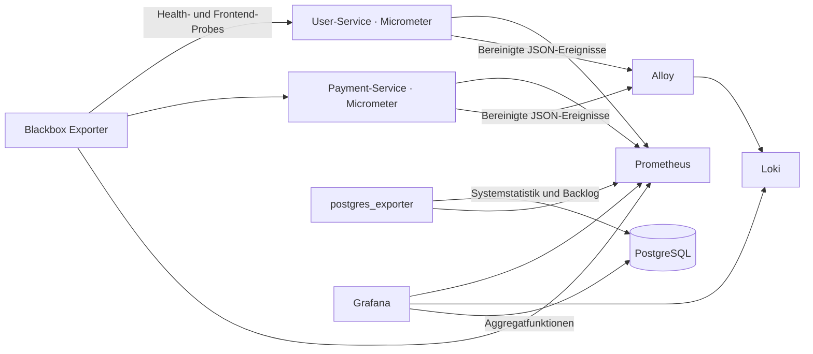

# Architektur und Evidenz

| Prozess | Bestehender Nachweis | Neue Telemetrie und verfügbare Aussage |
| --- | --- | --- |
| Registrierung und Verifikation | `user_mgmt.users.created_at,email_verified,deleted_at`, Migration 001/011, `UserController` und `AuthController` | HTTP-Erfolgsquote und Kategorien. Verifikationszeitpunkt historisch unbekannt. |
| QR und Checkout | `PublicTipCheckout.tsx`, `TipController`, `StripeCheckoutService`, `transactions.provider_reference` und neuer Audit | Controller-/Session-Timer und Zuordnung des gespeicherten Versuchs zur Stripe-Session. QR-Scans und verlassene Tabs unbekannt. |
| Zahlungsbuchung | Migration 002/007, `transactions.booked_at/status`, `StripeWebhookController`, `StripeCheckoutService.checkoutStatus` | Signierter Webhook oder serverseitige Prüfung der zugeordneten Stripe-Session kann die Buchung bestätigen. Ein Redirect allein erzeugt keine KPI-Buchung. |
| Pricing und Gebühren | `TipPricingSnapshot`, `payment_fee_audits` Migration 010/011/017, ältere Ereignisse in `payment_fee_events` | Eingefrorene Gebühren, Schätzungen, Steuer und Gegenprüfung von Istbeträgen. Der alte Eventstrom bleibt Detail-/Auditquelle. Historische Preise werden nicht neu berechnet. |
| Neuer Stripe-Audit | Migration 019, `StripePaymentAuditor`, `StripePaymentAuditReader`, `stripe_payment_audit`, `stripe_payment_transfer_audit`, `stripe_payment_fee_audit`, `stripe_payment_audit_event` | Root-Audit liefert verdichtete Kosten und Plattformrest. Der Reader dedupliziert belegte Balance-Positionen. Kindtransfers werden ausschließlich für Transfer-, Empfänger- und Reversal-Metriken verwendet. Die Ereignistabelle zählt zugeordnete Webhooks je Versuch. Enrollment gilt nur für neue Zahlungen. |
| Team und Rollen | `pools.owner_id/status`, `pool_members`, Migration 009/017/019/020 und `PoolService` | Mitglieder und Mitgliedschaften separat aggregiert. Eine Person kann Mitglied und/oder Besitzer verschiedener Pools sein. |
| Pool-Settlement | `payment_mgmt.pool_transfers`, Migration 006/008, `PoolTransferSettlementService`, `PoolReconciliation` | Allokation, erster Stripe-POST, bestätigte Transfer-ID, Provider-Zeitpunkt und Reversal als verschiedene Vorgänge. Terminales FAILED fehlt für diesen Pfad. |
| Connect | `connected_accounts`, Migration 003/009, `StripeStatusSync`, `StripeAccountStatus` | Gespeicherte Capability-Flags und Prüfalter. Aktuell Test-only. Die Tabelle enthält keine Stripe-Modusspalte. |
| Payouts | `transactions.type=PAYOUT`, `metadata.payoutVersion=1`, `PayoutStore`, `PayoutState`, `StripePayoutService` und Migration 015 | `STRIPE_SANDBOX` bezeichnet Simulation. `BOOKED` folgt Provider-Status `paid`. Bankgutschrift und Payout-Istgebühren sind unbekannt. |
| Infrastruktur und Release | `frontend/nginx.conf`, vorhandene `/health`-Endpunkte, `deployment/ecs/`, `.github/workflows/release.yml` und `deployment/scripts/deploy_ecs.sh` | Internes Scraping, Blackbox, cgroup v2 für Backend-Container, konfigurierte Build-ID. Kein lokaler Nachweis von AWS-Deployment-Zeit oder -Fehlern. |

Das vorhandene ECS-Modell nutzt ein gemeinsames Task-Template für Frontend und Backends, ein ALB-Ziel am Frontend, RDS PostgreSQL, ECR-Images und `awslogs`. Die Dateien belegen die vorgesehene Architektur. Für die Migration ist ein Abgleich mit der tatsächlich betriebenen VPC nötig. Lokal verwenden die App-Stacks das externe `gratilo-network` oder das Netzwerk des isolierten Stripe-Testprojekts. Die Monitoring-Demo veröffentlicht eigene, konfliktfreie Loopback-Ports.

Die Preis- und Statusdefinitionen folgen dem aktuellen Code und den Migrationen. Die Analyse berücksichtigt [Stripe-Zahlungs-Audit](../stripe-payment-audit.md), [Pool-Provision](../pool-platform-retention.adoc), [Mehrfach-Pools](../pool-many-to-many-dashboard.adoc), [Profil und Team](../dashboard-profile-team.adoc), [Pricing](../pricing-percentage-security-update.adoc), [manuelle Payouts](../manual-stripe-payouts.adoc), [Sandbox-Payout-Automation](../manual-sandbox-payouts-automation.adoc), [CI/CD](../cicd.md) und [ECS-Betrieb](../manual-ecs-production.md).

Traces und Tempo sind im lokalen Umfang ausgelassen. Kennzahlen, Probes und begrenzte strukturierte Ereignisse reichen für die vorgesehenen Diagnosepfade.
